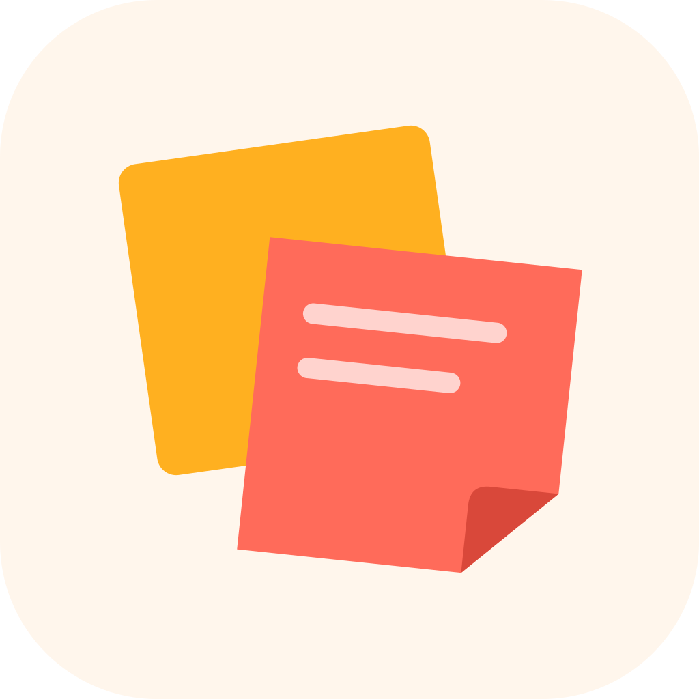

# Notaya

*Formerly Cipherleaf.* The app was renamed after version 1.1.0, when it became a notes app first.

Notaya is a notes app for Windows. You write in notebooks, sections and pages, build full databases, keep sticky notes on the desktop, and keep everything on your own PC, in one `data` folder, so the app can run from a folder or a USB stick.

**Your notes are saved locally.** They live in one file, `data\vault.nota`, on your PC or USB stick. There is no cloud, no account and no sync, and Notaya's own code has no network code, so your notes are never sent anywhere. One honest caveat: the window is drawn by Microsoft's WebView2 component, and in a test on Windows 11 it made background connections to Microsoft addresses at startup. What it sends was not captured, and Notaya does not currently stop it, so the app is not silent on the network. A web link in a note opens in your normal browser only when you click it.

Security is an optional extra. It is off by default: Notaya opens straight to your notes with no password. While it is off your notes are not private: anyone who can open the folder can read them. You can turn security on or off at any time in Settings.

> **Current release: Notaya 1.5.1** (published 2026-11-05, accepted by Mohamed Sayed the same day). It comes as a setup (`Notaya-V1.5.1-setup.exe`) and a portable ZIP (`Notaya-V1.5.1-portable.zip`) on the repository's Releases page. The repository is private for now, the exe is not code-signed (Windows SmartScreen may warn), and this page describes 1.5.1 only. What is and is not proven is in [`docs/acceptance.md`](docs/acceptance.md); the project's state is in [`docs/STATUS.md`](docs/STATUS.md). There is also a plain-language manual of the whole app ([how it is kept](docs/manual/README.md); the page itself is [`notaya-manual-first-edition.html`](docs/manual/notaya-manual-first-edition.html), download it and open it in a browser) and the [release notes](docs/release-notes/v1.5.1.md).

## Contents

- [Features](#features)
- [How to use it](#how-to-use-it)
- [Is it safe?](#is-it-safe)
- [Known limits in 1.5.1](#known-limits-in-151)
- [Credits and licenses](#credits-and-licenses)
- [Requirements](#requirements)

## Features

### Notes (the core)

- **Notebooks, sections and pages.** A notebook has a name, an icon and a color. It holds sections, a section holds pages, and a page can hold sub-pages to any depth. Databases sit in the same tree as pages.
- **Page icons and covers.** Pick an emoji (or a small picture) and a cover banner (gradient, color or your own picture, which you can reposition) for any page.
- **Home screen** with a banner, your favorites, recent pages and notebooks.
- **Sidebar.** Resizable and hideable (`Ctrl+\`). Every row has a `…` menu (open it with the keyboard using `Shift+F10`): add a section or page, rename, favorite, move, reorder, export, and move to Trash. Drag sections and pages to reorder them. The Trash lists deleted pages and databases with Restore, Delete forever and Empty trash, and moving a page to Trash shows an Undo.
- **Back and forward.** Backspace, `Alt+←` or the mouse's back button goes back; `Shift+Backspace`, `Alt+→` or the forward button goes forward (not while you type in a field).
- **A block editor.** Hover a block for its handle: `+` adds a block below, and the grip drags the block or opens its menu. Press `/` for the insert menu: paragraph, headings, bullet and numbered lists, checklists, collapsible sections (including the filled "shelf"), quote, highlight box, code block, divider, table, picture, equation, Mermaid diagram, sub-page, link to page, inline or linked database, and today's date. Markdown typing works too (`#` then space for a heading, `-` for a bullet, and so on).
- **Formatting bar** on selected text: turn into, font, size, bold, italic, underline, strikethrough, code, link, 18 text colors and 18 highlight colors, alignment, equation and remove formatting. A ribbon with Home, Insert and Table tabs offers the same tools.
- **Links.** Link a word to a web address, another page or a heading. `Ctrl+click` opens a web link in your browser (http and https only).
- **Pictures.** Add with `/Picture`, paste, or drag and drop. PNG, JPEG, GIF and WebP up to 25 MB, stored inside the vault. Place a picture anywhere on the page, or to the left or right so text wraps around it; resize by percentage or by ratio, crop, align and add a caption.
- **Equations and diagrams.** Equations are typed as TeX (for example `$x^2$`). Diagrams are written as Mermaid text (flowchart, sequence, class, state, Gantt, pie, ER, mind map, Git graph). Both are drawn on your PC; nothing is fetched.
- **Arabic and right-to-left writing.** Each block picks its direction from its first strong letter, so Arabic and Hebrew run right to left on their own; a line made with `Shift+Enter` follows its own language; buttons force a direction. It works in pages, databases and sticky notes.
- **Search.** `Ctrl+K` searches pages, databases, rows, notebooks and sticky notes as you type, or runs a command (New page, New sticky note, Export, Import pages, Back up vault now, and Lock vault when security is on). It remembers your last five searches.
- **Autosave.** Pages save about half a second after you stop typing. The page bar shows the save state ("Saved on this drive", or "Saved & encrypted" when security is on).

### Databases

- **A database is a table of rows, and each row is also a page.** Make one from the sidebar, a section or page menu, `/` inside a page, or from a CSV file. It can be a full page or sit inside another page, and a linked view can show a database made elsewhere.
- **23 property types:** text, number, select, multi-select, status, date (with reminder), person, files (up to 900 MB each), checkbox, URL, email, phone, formula, relation, rollup, created and last-edited time and person, ID, place and button.
- **Seven views:** table, board, list, gallery, calendar, timeline and chart (bar, line, donut or one number; click a bar to see its rows). A database can hold several views, each with its own nested filters, sorts, groups and footer calculations.
- **Formulas, relations and rollups** work between databases in both directions. Rows can be nested as sub-items, depend on each other, and be saved as templates.
- **Automations and the Button property.** When a row is added, a property changes or a date arrives, Notaya can set a property, add a row, show a message or move a row to Trash. Everything stays inside Notaya, and automations run only while it is open and unlocked.
- **Undo and redo** (`Ctrl+Z`, `Ctrl+Y`) for up to 50 database changes. Export a database view to CSV, Markdown, HTML, Word or PDF.

### Import and export

- **Export** a page, chosen pages, a section or a notebook to HTML, Markdown, PDF or Word, as one file or as separate files in a ZIP (a ZIP can be imported again). Exported files are **not encrypted**, and Notaya says so. PDFs print Arabic, Hebrew, Chinese, Japanese and Korean text; Greek, Cyrillic and emoji can still print as "?".
- **Import** Markdown, plain text, HTML, Word, PDF (text only), ZIP files, folders and CSV, up to 2 GB each. Imports always make a new notebook, with a progress bar and a Cancel button.
- **Notion exports** (Markdown and CSV, HTML, or both together) come in as real databases with their relations, plus icons, covers and callouts. Views, people and formulas do not carry over (formulas arrive as values).

### Sticky notes and calculators

- **Sticky notes** are small frameless windows on the desktop. Eight colors, bold, italic, checklist, "Keep on top", resize and move; position and size are remembered. They are saved in the vault and are searchable. With security on they hide when the vault locks. Closing one with the X keeps it in the vault; "Open all" and "Close all" show or hide every note, and Select lets you delete several at once.
- **Calculator.** A basic and scientific calculator (Deg/Rad, Copy, percent such as `200 + 10%`) in its own small window, from the Sticky notes screen or from a sticky note. Open as many as you like. They share one history of the last 500 calculations, saved in your vault (encrypted when security is on); Clear empties it.

### Looks and Windows (Settings)

- **Themes:** Sunrise (the default), Sunrise dark, Black, Graphite, White, Paper, or Match Windows. Accent color (presets or your own), font, text size, page width (Narrow to Full), density, window material (Solid, Mica or Acrylic, the last two on Windows 11), the lock screen background and the color new sticky notes start with.
- **System tray.** Closing the window hides Notaya in the tray (on by default; with security on it locks first). The tray menu offers Open Notaya, Close sticky notes and Quit Notaya. **Start with Windows** and **Start minimized** are switches in Settings.
- **Error log.** Crashes and errors are recorded on your PC, never with note text and never sent anywhere. Settings, Error log shows it and opens its folder.

### Optional: security

By default security is **off**: notes open straight away, nothing locks, and screenshots of the app are allowed. When you turn it on you get:

- A **master password** that unlocks your notes (at least 10 characters and a "Strong" rating). You can add an optional **keyfile**, a file that must be present as well.
- **Auto-lock** after 1 to 60 minutes of inactivity (5 to start with).
- Lock when you press `Win+L`, when the PC sleeps or hibernates, and when the drive with the vault is removed. Optionally lock when the window is minimized.
- A **Lock** button in the title bar and `Ctrl+L`.
- A short wait after wrong passwords (none for the first two tries, then 2 seconds, doubling up to a minute).
- **Block screenshots & screen sharing**: its own switch, **off** until you turn it on. It is never switched on for you.
- **Change master password and keyfile** in Settings. This also makes a new data key and re-encrypts your notes. Older backups still open with the old password, so keep them somewhere safe or delete them.
- **Turn off security** from Settings, at any time (see below).

### Backups and restore

- **Automatic backup** when the app quits, and also when the vault locks if you use security, if something changed. Saved in `data\backups`; the newest 10 are kept.
- **Hourly backup (security off only).** An open vault never locks, so while you work it is also backed up about once an hour if something changed (`vault-hourly-<number>.nota`; the newest 3 are kept).
- **Safety backup before a delete.** Before a notebook or section is deleted, Notaya makes a backup first (`vault-predelete-<number>.nota`). If it can't be made, nothing is deleted. The newest 5 are kept. A safety backup is also made before the first database is created in a vault.
- **Save a backup copy** from Settings, or "Back up vault now" in the `Ctrl+K` menu, saves a copy wherever you choose. If a backup fails, Notaya shows a message.
- **Restore** from the lock screen, from Settings, or from the start screens. Notaya checks the backup first and keeps your current file as `restore-undo-....nota`. Nothing is deleted.
- **Start over** sets a vault you can't open aside as `set-aside-....nota` and lets you start new notes. Nothing is deleted, and you can bring the old file back with Restore.

### Install or portable

Both downloads are the same app.

- **Setup.** Installs Notaya for the current Windows user (no administrator prompt) with a Start menu shortcut and an optional desktop shortcut. Your notes live in `%LOCALAPPDATA%\Notaya Notes\data` (Settings, "Open data folder" opens it). Uninstalling removes the program and never your notes. To update, run the newer setup over the old one (close Notaya first). On its first start with no notes, an installed Notaya asks whether to start new notes or **import the notes of a portable copy**: choose the portable Notaya folder; your notes and backups are copied and the portable folder is not changed. An installed and a portable Notaya cannot run at the same time, because starting the second only brings the first to the front. The setup downloads Microsoft's WebView2 only if the PC lacks it. It is not code-signed, so Windows SmartScreen may warn: choose "More info", then "Run anyway".
- **Portable.** Everything lives in the `data` folder next to `Notaya.exe` (the ZIP has a `portable.txt` file that makes it so; keep it, and always copy the whole folder, because a lone `Notaya.exe` without it counts as an installed copy and keeps its notes on that PC). Copy the folder to move your notes. Do not share `data\` with other people: it holds your notes.

## How to use it

### Getting started

1. Run the setup, or unzip the portable folder anywhere (a normal folder or a USB stick) and run `Notaya.exe`.
2. The first time, Notaya opens straight to your notes. There is no password and nothing to set up. You can also import notes from another app or from a portable copy.
3. Click **Create your first notebook** (or the `+` next to Notebooks). Give it a name, an icon and a color.
4. Press `Ctrl+N` or "New page", click the title at the top and type it, then press Enter to move into the page.

### Writing notes

- Press `/` to insert headings, lists, checklists, tables, pictures, equations, diagrams, databases and more. Select text to get the formatting bar.
- Use the `…` menu next to a page to add a page inside it, favorite it, move it, export it or send it to Trash.
- Press `Ctrl+K` to search everything, or to run a command.
- Useful keys: `Ctrl+K` search, `Ctrl+N` new page, `Ctrl+,` Settings, `Ctrl+\` show or hide the sidebar, `Ctrl+1` Notes, `Ctrl+3` Sticky notes, `Ctrl+L` lock (when security is on), `Ctrl+Z` and `Ctrl+Y` undo and redo.
- Sticky notes: open "Sticky notes" in the sidebar and press "New note". In its top bar, the dot picks the color and the pin switches "Keep on top" off or on. The X closes the note (it stays in the vault) and the bin deletes it.

### Turn security on

1. Open **Settings** and find **Security (optional)**. Press **Turn on…**.
2. Choose a master password (a long phrase of several unrelated words is easy to remember and strong) and write it down somewhere safe. Add a keyfile if you want one ("Create new" or "Use existing"). Confirm that you understand there is no password reset.
3. Leave "Delete earlier backups made while security was off" ticked unless you want to keep them. Notaya saves a fresh protected backup first and deletes the `vault-*.nota` (and `.clf`) files in `data\backups` that open without a password. Your own backup copies saved elsewhere, `restore-undo` and `set-aside` files are never deleted.
4. Press **Turn on security**. Your notes get a new key under the new password; this takes a moment, longer for big notebooks.
5. From now on the app locks as described above, and you unlock with the password (and keyfile).

### Turn security off

1. Unlock the vault as usual, open **Settings**, **Security (optional)**, and press **Turn off security…**.
2. Read the warnings, type your current master password (and choose your keyfile if you use one), and confirm.
3. Press **Turn off security**. The notes then open without a password. A wrong password changes nothing and counts toward the wait after wrong passwords.

With security off, your notes are saved in Notaya's file format, which is tamper-checked, but the key is a **public key built into the program**. So your notes are **not private**: anyone who has your `vault.nota` or a backup, and a copy of Notaya, can read them. The app says so on the Home screen until you dismiss the note.

### If you forget the password

There is no reset and no recovery. If you lose the master password, or a keyfile you required, the notes cannot be opened. The way forward is **Start over…** on the lock screen: type START OVER and press "Set aside and start over". Your old vault is set aside (never deleted); then press "Start new notes". If you find the password later, use **Restore from a backup…**, choose the `set-aside-....nota` file in `data\` and type its password.

### Restoring a backup

Choose **Restore from a backup…** (lock screen, start screens, or Settings), pick a backup from the list or "Choose another backup file…", enter "Password of this backup" if it has one, and press "Replace my vault with this backup" ("Restore backup" on the start screens). Your current vault is kept as `restore-undo-....nota`. To get a deleted notebook back, restore the safety backup made before it was deleted. A backup made while security was off needs no password; restoring one onto a vault that has a master password asks you to confirm that security will be turned off.

### Moving or backing up the folder

Close Notaya, then copy the whole folder (`Notaya.exe` and `data`). Moving the folder to another drive or PC does not change the password or the keyfile. A keyfile is identified by its content, so keep the same file, not a copy that has been edited.

### Updating from an older version

- **From Cipherleaf or Notaya 1.3.0 or older.** Your notes, backups and settings open in Notaya. The first time it starts, it makes `data\vault.nota` from your old `data\vault.clf` (the old file is kept as `data\vault-before-notaya.clf`; Notaya does not delete it on its own). Old `.clf` backups still open. After that, use the new Notaya only; older versions cannot open the new files.
- **To Notaya 1.5.x.** Once a vault holds a database, Notaya 1.4.0 and older cannot open it. Notaya makes a backup before the first database is created.
- **KeePassXC is no longer part of Notaya** (since 1.1.0). A passwords file made with an earlier version (`data\passwords.kdbx`) is left in the `data` folder as it is. To open it, use KeePassXC itself (<https://keepassxc.org>).

### Troubleshooting

- **"Wrong master password or keyfile for this Notaya vault."** If the vault uses a keyfile, it must be the exact file chosen when the vault was made.
- **"The vault file couldn't be read."** Another program (antivirus or a sync tool) may be using the file. Press "Check again" or "Try again". If it stays, use Restore or Start over.
- **"No notes found here."** The folder has backups but no current notes file. Restore a backup, or start new notes.
- **"Notaya could not start".** Either Notaya cannot save its data in the `data` folder next to the app (usually a read-only folder such as a write-protected USB stick or Program Files: move the whole folder somewhere you can write to), or it cannot open its window (usually a missing Microsoft WebView2 Runtime: install the "Evergreen" runtime from Microsoft's website).
- **Windows SmartScreen warns about the exe.** The exe is not code-signed. Choose "More info", then "Run anyway" if you trust where you got it.
- **A big import is slow or fails.** A very large import uses a lot of memory (about 1.2 GB for a 120 MB Markdown ZIP). Split big exports into parts.

## Is it safe?

Short answers. The full list is in [`docs/security-design.md`](docs/security-design.md).

- **Local only, no network code.** Notes are saved only in `data\vault.nota` on your PC. Notaya's own code makes no connections (the page security policy allows only the app's internal channel). The WebView2 component that Windows uses to draw the window is Microsoft's, and a live test showed it contacting Microsoft addresses at startup; Notaya does not currently stop that and does not claim zero network traffic. A web link in a note opens in your browser only when you click it.
- **With security on:** notes are encrypted with XChaCha20-Poly1305, with the key derived from your password by Argon2id (256 MiB, 3 passes), and tampering is detected. Keys stay in the program's Rust core and never reach the screen layer.
- **With security off, the notes are readable by anyone with the folder.** This is by design, and it is stated in Settings.
- **Exports are not encrypted.** Notaya warns you before it saves one.
- **The exe is not signed.** Windows SmartScreen may warn. Notaya does not check itself, so a replaced exe would not be noticed.
- **No password reset.** See above.
- **The lock screen and screenshots.** The lock screen of a protected vault is hidden from screenshots only when the app starts. After a lock during the session it follows your screenshot setting, which is off by default.
- **Not defended:** malware or a keylogger on the PC, someone with administrator rights, reading memory while the app is open, and a file swapped by someone who can write to your `data` folder (for example replacing a protected vault with an open one).
- **What is proven.** Most checks are unit tests and scripted runs of the real app on throwaway data; the exact list, and what was not run, is in [`docs/acceptance.md`](docs/acceptance.md) and the [release notes](docs/release-notes/v1.5.1.md). Mohamed Sayed accepted 1.5.1 on 2026-11-05. Not yet run: the 1.5.x setup installers, the tray entry "Close sticky notes", and Clippy on the final commit.

## Known limits in 1.5.1

Things that do not work the way you might expect today (the manual lists them all):

- **Right-click** does not open Notaya menus yet. Use the `…` button.
- **No find bar** for the open page yet, and a search result opens the page without highlighting the match. Notaya always opens on Home, not on the page you were on.
- A **database placed inside a page** is left out of page exports (export the database from its own menu), and a second import of the same files makes a second notebook.
- **PDF** has no contents page, and Greek, Cyrillic and emoji can print as "?" (Word keeps them).
- Databases: one chart per view (no pie chart or dashboards); the timeline slows above about 500 rows; automations run only while Notaya is open and unlocked, and reminders are messages inside Notaya, not Windows notifications.
- A vault that holds a database cannot be opened by Notaya 1.4.0 or older.

## Credits and licenses

Notaya is made by **Mohamed Sayed** ([AbyssWatcher2](https://github.com/AbyssWatcher2), who owns the repository) and **Ahmed Emara** ([AE0101](https://github.com/AE0101)), built together with AI assistants.

Notaya is built on open source software, and we are grateful to everyone who made it:

- **[Tauri](https://tauri.app)** and the Rust crates it and Notaya use (RustCrypto for the encryption, SQLite for storage, and others).
- **npm packages** for the interface: React, TipTap and ProseMirror (the editor), KaTeX (equations), Mermaid (diagrams), highlight.js (code colors), lucide icons, Radix, and others.
- **Fonts:** Inter and JetBrains Mono (SIL Open Font License 1.1), the KaTeX fonts, and the Arabic and Hebrew fonts bundled for PDF export.
- **Microsoft Edge WebView2** shows the interface (required, not bundled).

Every component is listed in [`THIRD-PARTY-NOTICES.md`](THIRD-PARTY-NOTICES.md) with its version, copyright holder and license, together with the license texts that go with it. That file is also in the `Licenses` folder of the portable copy and inside the app (Settings, About, "Open source licenses…"). This is attribution, not legal advice.

**The license for Notaya itself has not been chosen yet.** Until both partners decide, no license is granted to use, copy or share Notaya's own code.

## Requirements

- Windows 10 or 11, 64-bit, with the Microsoft Edge WebView2 runtime (already part of Windows 11 and most Windows 10 installs).
- The window is at least 960 by 640 pixels. Mica and Acrylic window materials need Windows 11. Unlocking a password-protected vault uses about 256 MB of memory for a moment.
