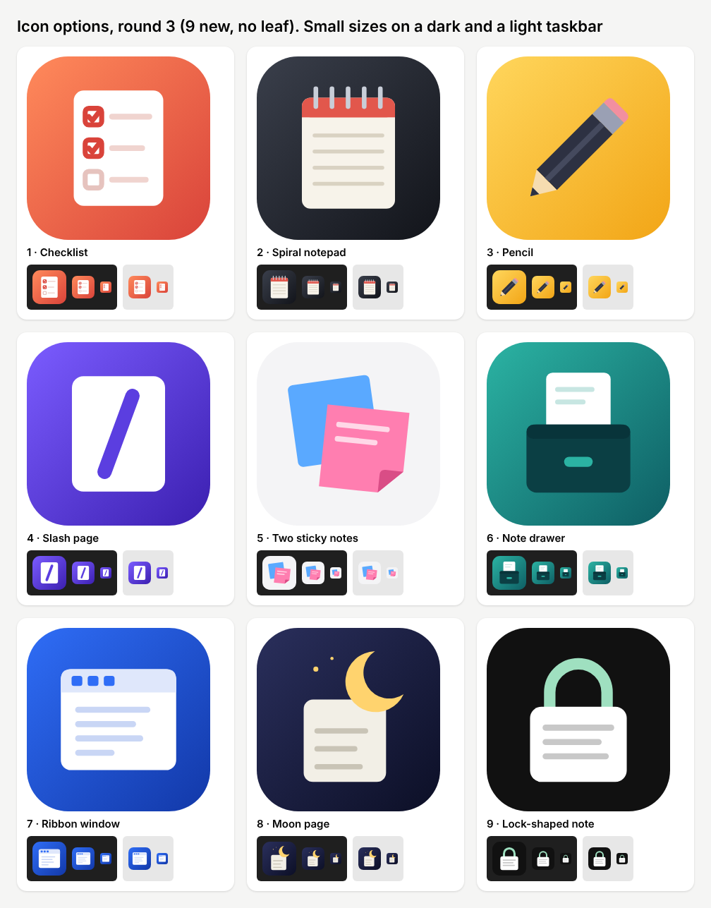
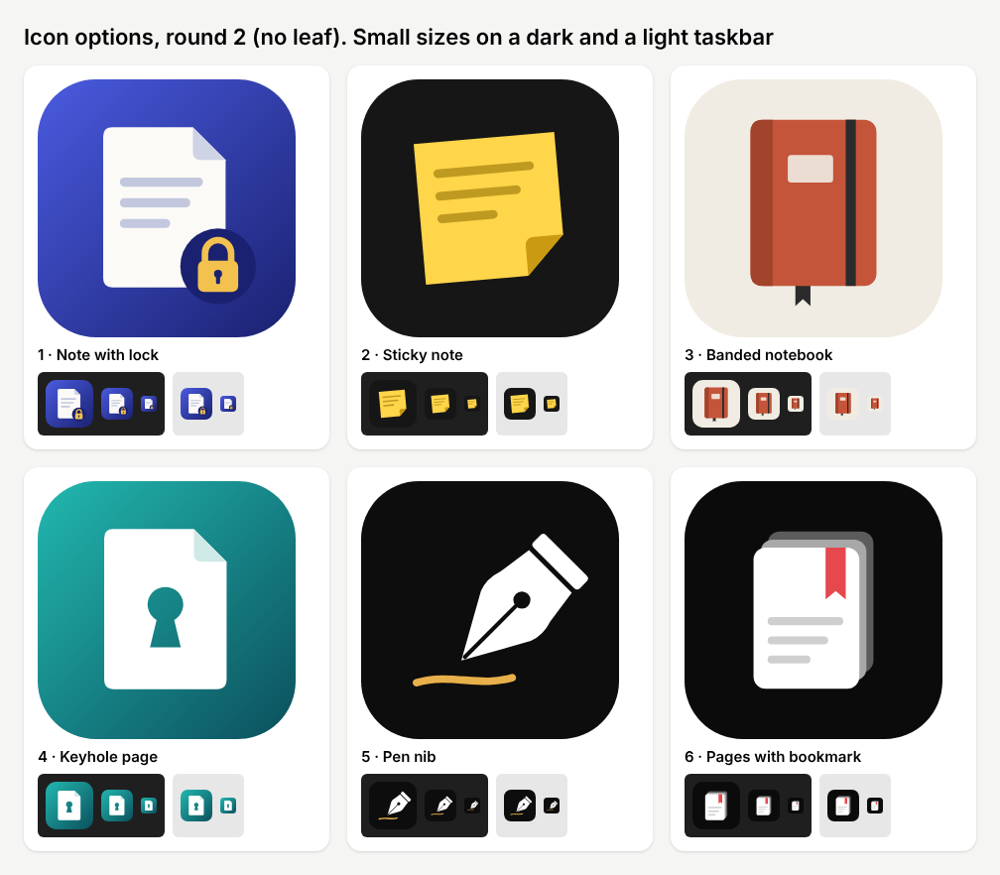

# New app icon and name: options (discussion only)

**Status:** options for the owner to choose from. Nothing in the app has changed: the icon files in `src-tauri/icons/`, `assets/cipherleaf-icon.svg` and the name "Cipherleaf" in the code are untouched. Building starts only after the owner picks and says go.

**Asked (times from the project transcript, UTC, 2026-10-27):**
- 13:31:51 "Okay let's design some new icons give me choices and new names"
- 13:32:44 "Cause you know something has been changed"
- 13:46:09 "I don't need leaf" (after round 1). No leaf in any later icon or name.
- 15:03:34 "something related like everything in one place" and 15:05:29 "Another give me 10 names". Rounds 4 and 5 below answer them.
- 13:50:08 "New set 9 icons" and 13:50:37 "And names that no company has it ot trademark" (after round 2). Round 3 below answers both.

## Decisions so far (owner's picks, 2026-10-27, times from the project transcript, UTC)

- **Icon:** round 3, option 5, two sticky notes ("That 2 sticky notes really good one", 14:00:13).
- **Theme:** **Sunrise** ("Sunrise", 14:29:43). The icon would use the Sunrise colours, which is [`themes/2-sunrise-icon.svg`](../themes/2-sunrise-icon.svg) (amber `#ffb020` back note, coral `#ff6b5a` front note, accent `#e8553f`). That pairing is Kevin's reading of the pick; the owner can still ask for the original blue and pink.
- **Name:** not chosen yet.
- **Build:** not started. It waits until the owner picks a name and says go.

## Round 6 names: like PocketNote and MicroNote (current)

**Asked:** "Can you generate something similar for those names" (Mohamed, 2026-10-27 15:51:19 UTC, from the project transcript), after the screen found that PocketNote and MicroNote are already used (see [../themes/pocketnote-micronote/](../themes/pocketnote-micronote/README.md)). These are short "small thing + note" names in the same spirit. Same best-effort web screen as before: apps, companies and trademark listings for each exact name. This is not legal clearance, and the official databases were not reachable.

**Passed the screen.** Pocket-style names:

| Name | Why | Screen notes |
|---|---|---|
| **Pocketling** | A little pocket that holds everything. | No exact match. "Pocket" is a well-known app brand, so the "-ling" ending matters. |
| **Satchelnote** | Notes in a satchel you carry. | No match. |
| **Pouchnote** | A pouch for your notes. | No exact match, but it sounds close to "Pocket Note". Weaker. |
| **Cubbynote** | A cubby hole for every note. | No exact match; "CubeNote" exists. Weaker. |
| **Microcove** | A tiny cove for everything. | No exact match; "Cove" is a common app name. Weaker. |

Micro-style names:

| Name | Why | Screen notes |
|---|---|---|
| **Specknote** | A speck is tiny, like "micro". | No match. |
| **Thimblenote** | Small as a thimble, holds what matters. | No match. |
| **Teenynote** | Teeny-tiny notes. | No exact match; "WeeNote" exists. Weaker. |
| **Pennynote** | Small and handy, like a penny. | No exact match; "Penned" and "Pencil Note" exist. Weaker. |
| **Acornnote** | Small, but holds a lot. | No exact match; "Acorn" is a well-known Mac image editor. Weaker. |

**Checked and dropped:** Pipnote (PiP Notes, PPNote), Pebblenote (Pebble Notes), Crumbnote (an App Store app called CrumbNote), Snipnote (SnipNote and SnipNotes apps), Seednote (a Seedsnote extension), Minimnote and Minipage (MiniNote, MinNote and Mini Notes apps), Mitenote (mitynote app), Pocknote (a "pocketnote" software package), Pocketnook (Barnes & Noble's Nook), Pocketkin (Pocketkins toys), Wrennote (Wren apps), Jotlet (an existing Jotlet software project), Notekin (close to "Notchkin").

**Recommendation (round 6):** **Specknote** for the "micro" feel, or **Pocketling** for the "pocket" feel. Both came out clean, and both fit the Micro Sunrise or Sunrise pocket themes.

## Round 5 names: 10 more, "everything in one place"

**Asked:** "Another give me 10 names" (Mohamed, 2026-10-27 15:05:29 UTC, from the project transcript). None of these repeats an earlier round. They were screened the same way as round 4: a web search for each exact name, looking for apps, companies and trademark listings. This is best effort and not legal clearance, and the official USPTO, EUIPO and WIPO databases were not reachable.

**All 10 passed the screen (no app, company or trademark with this exact name found):**

| Name | Why | Screen notes |
|---|---|---|
| **Onedrawer** | Everything in one drawer: notes, stickies, calculators. | No match (only the generic "app drawer"). |
| **Everynook** | A nook for every kind of note, all in one app. | No match. |
| **Onecove** | One sheltered cove where everything is kept. | No match. |
| **Pocketcove** | A small cove you carry with you (the portable ZIP). | No match. |
| **Wholenook** | The whole lot, in one nook. | No match (a place called Woolenook in Australia). |
| **Holdnook** | A nook that holds it all. | No match. |
| **Kithaven** | A safe haven for your whole kit. | No match. |
| **Allroost** | Everything comes home to roost in one place. | No match (an unrelated UK company, "Allro Limited"). |
| **Allburrow** | One cosy burrow for all of it. | No match. |
| **Snugstash** | A snug stash for everything. | No exact match; "Snugpak" (outdoor gear) is a similar-sounding brand. |

**Checked and dropped this round:** Allcove (the "Alcove" apps), Covepad ("Cove" apps and backup software), Allnest (an app called "Allnest" with documents, calculators and a vault already exists), Nestpad (Google Nest), Onecrate and Allcrate ("Crate" apps), Bundlepad (Vic Firth and Zildjian "Bundle Pad" products), Tuckpad ("Tucks" pads), Homebin (HomeBinder), Onehold (OneHome and AppHold apps), Onelodge (hotels called "One Lodge"), Onetrove and Trovepad ("Trove" and TaskTrove), Allharbor ("Harbor" apps).

**Recommendation (round 5):** **Onedrawer**. It is the plainest way to say "everything in one place", and it is easy to say and to spell. Runner-up: **Everynook**. Onenook from round 4 is still my overall favourite for its cosy feel.

## Round 4 names: "everything in one place"

**Asked:** "So about the names. What about something related like everything in one place. Suggest" (Mohamed, 2026-10-27 15:03:34 UTC, from the project transcript). The idea: notes, sticky notes, calculators and the optional lock all in one app.

**What was checked (2026-10-27, best effort, not legal clearance):** the same screen as round 3. Each exact name got a web search for apps (App Store, F-Droid, Product Hunt, AlternativeTo), companies and trademark listings. The USPTO, EUIPO and WIPO databases still could not be read from this environment, so search your pick there yourself before you commit (links in the round 3 section below).

**Passed the screen (no app, company or trademark with this exact name found):**

| Name | Why | Screen notes |
|---|---|---|
| **Onenook** | One cosy nook where everything lives. | No match (only a holiday rental called "The Onemana Nook"). |
| **Allstow** | Stow it all: notes, stickies, calculators. | No exact match. "AllStays" is a camping app, a different field but a similar sound. |
| **Stowpad** | A pad you stow everything on. | No match. |
| **Wholepad** | The whole lot on one pad. | No match. |
| **Kitnest** | Your whole kit in one nest. | No match. |
| **Allhaven** | A safe haven for all of it. | No match. |
| **Deskhold** | Holds everything on your desk. | No product with this name; close to the common phrase "desk holder", so it is harder to search for. |

**Dropped:**

| Name | What was found |
|---|---|
| Onefold | A product called Onefold is listed on HuntScreens. |
| Onestash | "Stash" is a well-known investing app and brand. |
| Allkeep | "Keep" is Google's notes app (Google Keep). |
| Totepad | "TowPad" and "Tot" are existing note and text apps. |
| Gatherpad | "Gather" is a well-known software brand. |
| Allfold, Tidybase | Close to existing apps ("Alle Folders", "TIDY", "TidyBox"). |

**Recommendation (round 4):** **Onenook**. It says "everything in one place" and has the same cosy, personal feel as the sticky-notes icon and the Sunrise theme. Runner-up: **Allstow**.

## Why a new identity

The name and icon came from the first plan, when Cipherleaf was a password-locked vault with KeePassXC bundled. Since V1.1.0 (2026-10-27) KeePassXC is gone and the app is notes-first: pages and sub-pages, a ribbon editor with a `/` menu, sticky notes, pop-out calculators, all stored locally. The password lock and encryption are still there but optional (A21). So the new icon and name should say "notes" first and "private, on your PC" second.

## Round 3 icon options (current)

Nine new 1024 × 1024 SVGs in [`round-3/`](round-3/), all different from rounds 1 and 2, none with a leaf. The sheet shows each at full size and at 48, 32 and 16 px on a dark and a light taskbar.

| | Option | Idea |
|---|---|---|
| 1 | [Checklist](round-3/1-checklist.svg) | A page with ticked boxes, on coral. Notes and to-dos. |
| 2 | [Spiral notepad](round-3/2-spiral-notepad.svg) | A spiral-bound pad with a red top, on charcoal. Instantly "notepad", clear at 16 px. |
| 3 | [Pencil](round-3/3-pencil.svg) | A bold pencil on yellow. Simplest shape, very readable small. |
| 4 | [Slash page](round-3/4-slash-page.svg) | A page marked "/", the editor's quick-insert menu, on violet. |
| 5 | [Two sticky notes](round-3/5-two-sticky-notes.svg) | Blue and pink sticky notes overlapping, on a light tile. |
| 6 | [Note drawer](round-3/6-note-drawer.svg) | A page tucked into a drawer: all your notes kept in one place on your PC. |
| 7 | [Ribbon window](round-3/7-ribbon-window.svg) | An app window with a ribbon toolbar over a page: the editor itself. |
| 8 | [Moon page](round-3/8-moon-page.svg) | A crescent moon over a page: quiet and private. |
| 9 | [Lock-shaped note](round-3/9-lock-shaped-note.svg) | A padlock whose body is a lined note: notes with the lock built in. |

## Round 3 name options, with a name-clash screen

**What was checked (2026-10-27, best effort, not legal clearance):** a web search for each exact name, looking for apps (App Store, Microsoft Store, F-Droid, Product Hunt, AlternativeTo), companies and trademark listings (Justia's copy of US trademark records). The official databases (USPTO, EUIPO, WIPO Global Brand Database) could not be read from this environment (they need a browser), so they were **not** checked. Before committing to a name, search it yourself in the [WIPO Global Brand Database](https://branddb.wipo.int/), [USPTO trademark search](https://tmsearch.uspto.gov/) and [EUIPO eSearch](https://euipo.europa.eu/eSearch/) for class 9 (software), check the Microsoft Store, and see whether the .com / .app domain is free. For real protection, ask a trademark lawyer.

**Passed the screen (no app, company or trademark with this exact name found):**

| Name | Why | Screen notes |
|---|---|---|
| **Pagemoor** | Your pages moored safely in a quiet harbour, on your own PC. | No match found. |
| **Quillory** | A place for your quill: writing first. | No match found (only unrelated "Quill" books and awards). |
| **Pennook** | A pen and a nook: a small private corner to write in. | No match found. Sounds close to Pennacook, a Native American people; worth considering. |
| **Scribvale** | A quiet valley for your scribbles. | No match found. |
| **Inkwhile** | "Write for a while": calm, unhurried notes. | No match found. |
| **Inkhollow** | A hidden hollow where your ink stays. | No match found (only place names). |
| **Quillnook** | A writing nook. | No software match; a farm stay called "Quill Nook Farm" exists (different field). |
| **Notevale** | A valley of notes. | No exact match, but it sounds like "NoteVault", a name several note apps use. Weaker. |
| **Scrivlet** | A small writing tool. | No exact match, but close to Scrivener (well-known writing software). Weaker. |

**Dropped because something already uses the name or something very close:**

| Name | What was found |
|---|---|
| Hushpad, Hushfolio, Pagehush | "HUSH" is a registered trademark family in software (Hush Communications / Hushmail, Hush Technology). |
| Quietpad | Drumeo sells a product called QuietPad. |
| Pagekeep | "Pagekeeper" is an app on F-Droid. |
| Notenook | An app called Notenook is on the App Store. |
| Velnote | "VelNotes" is a notes app on the App Store. |
| Jotkeep, Jotvale | Several note apps are called "Jot". |
| Stillnote | "Still" is a journaling and notes app. |
| Pagewell | Appears as a journal brand in shop listings. |
| Round 2 names | Superseded; Quietpad and Hushpad clash as above, and Folio and Margin are common words already used by many products. |

## Recommendation (round 3)

**Name: Pagemoor.** It is calm, it says "pages", it hints at keeping them safe, and nothing was found using it. Runner-up: **Quillory**.
**Icon:** **2 (Spiral notepad)** is the clearest at taskbar size and says "notes" at once; **9 (Lock-shaped note)** if you want the optional lock to show. Any icon works with any name.

## Round 2 icon options (history)

Six 1024 × 1024 SVGs in [`round-2/`](round-2/). Any chosen icon goes through `npx tauri icon <file>.svg` (the same step as [A15](../../plan/A15-app-icon.md)). The sheet shows each at full size and at 48, 32 and 16 px on a dark and a light taskbar.

| | Option | Idea | Notes |
|---|---|---|---|
| 1 | [Note with lock](round-2/1-note-with-lock.svg) | A paper note with a small gold padlock badge, on indigo | Says both things in the right order: notes, then lock. |
| 2 | [Sticky note](round-2/2-sticky-note.svg) | A yellow sticky note with a lifted corner, on black | The clearest at 16 px. Matches the sticky notes feature. |
| 3 | [Banded notebook](round-2/3-banded-notebook.svg) | A notebook with an elastic band and a ribbon bookmark | Personal and "kept closed" without a lock symbol. Light tile. |
| 4 | [Keyhole page](round-2/4-keyhole-page.svg) | A page with a keyhole cut through it, on teal | One simple shape; leans a bit more towards "lock". |
| 5 | [Pen nib](round-2/5-pen-nib.svg) | A fountain-pen nib drawing a gold line, on black | About writing; says nothing about privacy. |
| 6 | [Pages with bookmark](round-2/6-pages-with-bookmark.svg) | Stacked pages (pages and sub-pages) with a red bookmark | Keeps today's black-and-white app look. |

## Round 2 name options (history)

Superseded by round 3; see the screen above for the clashes found.

| Name | Why |
|---|---|
| **Hushpad** | A quiet, private notepad. "Hush" hints at the optional lock without making it the point. |
| **Quietpad** | Calm and offline: no account, no network, nothing leaves your PC. |
| **Pagekeep** | It keeps your pages and sub-pages, on your own computer. |
| **Stillnote** | Calm, simple notes. |
| **Jotkeep** | For quick jots and sticky notes that stay put. |
| **Homepad** | Your notes stay at home, on your PC. |
| **Paperlock** | Paper plus a lock. Says "lock" more than the app now does. |
| **Folio** | Classic word for a set of pages. Very common, harder to search for. |
| **Margin** | Short; the place you jot things down. Very common word. |

## Recommendation (round 2, superseded)

**Icon 1 (Note with lock) with the name Hushpad.** Both say "notes first, private if you want it", which is what the app is now. Runner-up: **icon 2 (Sticky note) with Quietpad**, the friendliest and the clearest in the taskbar.

## Round 1 (history)

The first round used a leaf in every icon and most names. The owner turned the leaf down, so it is kept only as a record: [`round-1/`](round-1/README.md).

## What a rename would touch (for when the owner says go)

- Change: `productName` and the window title in `src-tauri/tauri.conf.json`, in-app text that says "Cipherleaf", the README and release names (exe and ZIP file names).
- Keep, so existing notes keep opening: the app identifier `app.cipherleaf.vault`, the `data\vault.clf` file and its format, and the `CIPHERLEAF_HOME` variable (or accept both old and new).
- Timing: rename before the Windows installer ships. The installer plan ([PR #23](https://github.com/AbyssWatcher2/CipherLeaf/pull/23)) puts installed data in `%LOCALAPPDATA%\Cipherleaf\data`; choosing the name first avoids a folder named after the old one.
- The new icon goes through the same steps as A15: regenerate `src-tauri/icons/`, clean the build (`cargo clean -p cipherleaf`), and expect Windows' icon cache to show the old icon on pinned taskbar entries until re-pinned.
