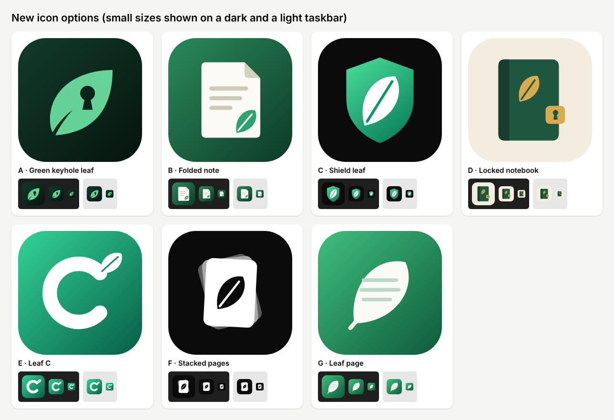

# Round 1 icon and name options (history: turned down)

> **Turned down:** the owner said "I don't need leaf" (2026-10-27 13:46:09 UTC). Current options are in [../README.md](../README.md).

**Status:** options for the owner to choose from. Nothing in the app has changed: the icon files in `src-tauri/icons/`, `assets/cipherleaf-icon.svg` and the name "Cipherleaf" in the code are untouched. Building starts only after the owner picks and says go.

**Asked:** "Okay let's design some new icons give me choices and new names" and "Cause you know something has been changed" (Mohamed, 2026-10-27 13:31:51 and 13:32:44 UTC, from the project transcript).

## Why a new identity

The name and icon came from the first plan, when Cipherleaf was a password-locked vault with KeePassXC bundled. Since V1.1.0 (2026-10-27) KeePassXC is gone and the app is notes-first: pages and sub-pages, a ribbon editor with a `/` menu, sticky notes, pop-out calculators, all stored locally. The password lock and encryption are still there but optional (A21). So the new icon and name should say "notes" first and "private, on your PC" second, rather than "cipher" or "password".

## Icon options

All seven are 1024 × 1024 SVGs in this folder, ready to feed `npx tauri icon <file>.svg` (the same step as [A15](../../../plan/A15-app-icon.md)). The sheet shows each at full size and at 48, 32 and 16 px on a dark and a light taskbar.

| | Option | Idea | Notes |
|---|---|---|---|
| A | [Green keyhole leaf](a-green-keyhole-leaf.svg) | Today's mark, recoloured green | Smallest change. Still says "lock" first. |
| B | [Folded note](b-folded-note.svg) | A paper note with a folded corner and a small leaf | Reads as "notes" instantly. Leaf is hard to see at 16 px. |
| C | [Shield leaf](c-shield-leaf.svg) | White leaf inside an emerald shield | Strongest "protected" message; looks like a security app, which the app no longer mainly is. |
| D | [Locked notebook](d-locked-notebook.svg) | Green notebook, gold clasp with keyhole, leaf on the cover | Notes plus optional lock in one picture. Light tile; busy at 16 px. |
| E | [Leaf C](e-leaf-c-monogram.svg) | A bold "C" that grows into a leaf | Only fits if the new name also starts with C. Very clear at small sizes. |
| F | [Stacked pages](f-stacked-pages.svg) | Three stacked pages (pages and sub-pages) with a leaf | Keeps today's black-and-white app look. |
| G | [Leaf page](g-leaf-page.svg) | The leaf *is* the page, with lines of writing on it | Notes and the leaf in one simple shape; clean at 16 px. |

## Name options

None of these has been checked for trademarks or existing apps with the same name; that check comes before a final choice.

| Name | Why |
|---|---|
| **Leafnote** | Says exactly what it is now (notes) and keeps the leaf, so the icon and existing users carry over. |
| **Quietleaf** | Calm and private: local only, no account, no network. |
| **Leafbook** | A notebook made of pages and sub-pages; pairs with icon D or G. |
| **Fernpad** | "Pad" covers notes, sticky notes and the calculator scratchpad. |
| **Pocketleaf** | The portable ZIP: the whole app and your notes in one folder you can carry. |
| **Inkleaf** | Writing first, the leaf stays. |
| **Margin** | Short; the place you jot things down. Very common word, harder to search for. |
| **Leaflet** | A leaflet is a small printed page, and a small leaf. Clashes with the well-known Leaflet map library. |
| **Cipherleaf** (keep) | No rename work and nothing for users to relearn, but "cipher" points at encryption, which is now optional. |

## Recommendation

**Icon G (Leaf page) with the name Leafnote.** It keeps the leaf people already know, says "notes" in both the picture and the word, and stays readable at 16 px in the taskbar. Runner-up: icon B with Quietleaf.

## What a rename would touch (for when the owner says go)

- Change: `productName` and the window title in `src-tauri/tauri.conf.json`, in-app text that says "Cipherleaf", the README and release names (exe and ZIP file names).
- Keep, so existing notes keep opening: the app identifier `app.cipherleaf.vault`, the `data\vault.clf` file and its format, and the `CIPHERLEAF_HOME` variable (or accept both old and new).
- Timing: rename before the Windows installer ships. The installer plan ([PR #23](https://github.com/AbyssWatcher2/CipherLeaf/pull/23)) puts installed data in `%LOCALAPPDATA%\Cipherleaf\data`; choosing the name first avoids a folder named after the old one.
- The new icon goes through the same steps as A15: regenerate `src-tauri/icons/`, clean the build (`cargo clean -p cipherleaf`), and expect Windows' icon cache to show the old icon on pinned taskbar entries until re-pinned.
