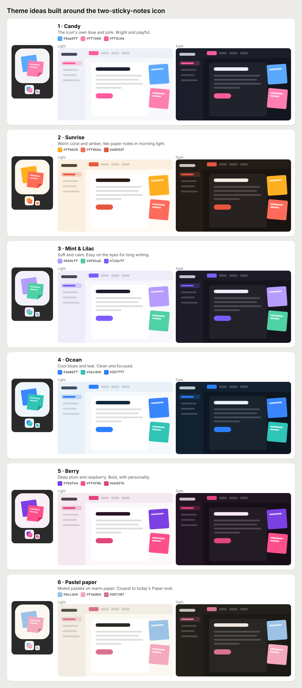

# Theme ideas to match the two-sticky-notes icon (discussion only)

**Status:** ideas for the owner to choose from. Nothing in the app has changed.

**Asked:** "That 2 sticky notes really good one. But can you give me ideas of themes can match it" (Mohamed, 2026-10-27 14:00:13 UTC, from the project transcript). The icon is round 3, option 5 in [../icon-options/](../icon-options/README.md).

## The ideas

Each theme gives the icon two note colours, an accent for buttons and the selected page, and a light and a dark version of the app. The sheet shows the recoloured icon (at full size, 32 px and 16 px) next to a simple mock-up of the app with the sidebar, the ribbon, a page and two sticky notes.

| | Theme | Back note | Front note | Accent | Feel |
|---|---|---|---|---|---|
| 1 | [Candy](1-candy-icon.svg) | `#5aa9ff` | `#ff7eb0` | `#ff5c9a` | The icon's own blue and pink. Bright and playful. |
| 2 | [Sunrise](2-sunrise-icon.svg) | `#ffb020` | `#ff6b5a` | `#e8553f` | Warm coral and amber, like paper notes in morning light. |
| 3 | [Mint & Lilac](3-mint-lilac-icon.svg) | `#b69cff` | `#4fd1a5` | `#7c5cff` | Soft and calm. Easy on the eyes for long writing. |
| 4 | [Ocean](4-ocean-icon.svg) | `#3a86ff` | `#2ec4b6` | `#2b7fff` | Cool blues and teal. Clean and focused. |
| 5 | [Berry](5-berry-icon.svg) | `#7b3fe4` | `#ff4f8b` | `#e0457b` | Deep plum and raspberry. Bold, with personality. |
| 6 | [Pastel paper](6-pastel-paper-icon.svg) | `#9cc3e6` | `#f4a9bd` | `#d9728f` | Muted pastels on warm paper. Closest to today's Paper look. |

## Recommendation

**Candy** as the main look. It uses the exact colours of the icon you picked, so the app and the taskbar icon match, and it works in both light and dark. **Pastel paper** is the calmer second choice and sits closest to today's default (Paper).

A good extra: keep all six as choices in Settings > Appearance, with the icon staying in Candy colours. Each theme's two note colours would also become the first two sticky-note colours.

## How this would fit the app (for when the owner says go)

The app already has looks (Black, Graphite, White, Paper) and a separate accent setting (`src/lib/theme.ts`, `src/styles/app.css`). Each theme here is a light and a dark set of the same colour tokens (`--bg`, `--sidebar`, `--text`, `--accent` and so on) plus two sticky-note colours, so it can be added as new choices without changing how settings are stored. The colours still need a contrast check (text on background, white text on the accent) before building.
