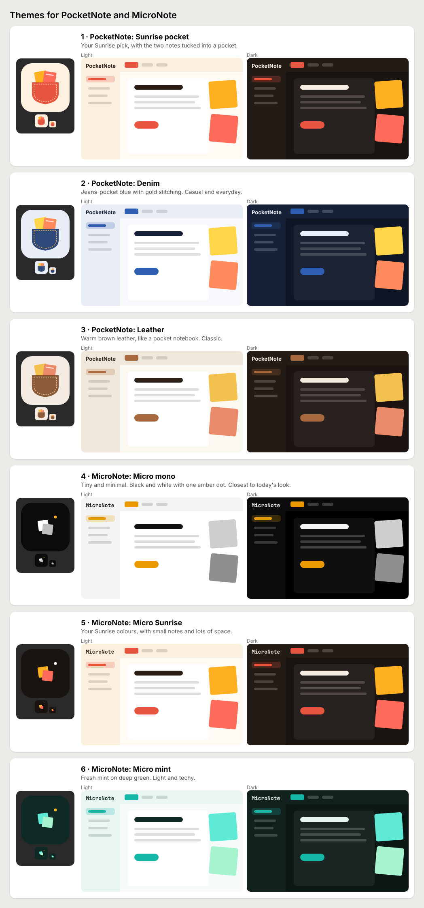

# Themes for PocketNote and MicroNote (discussion only)

**Asked:** "PocketNote, MicroNote. Can you do themes for those" (Mohamed, 2026-10-27 15:48:09 UTC, from the project transcript). These are the owner's own two name ideas. Nothing in the app has changed.

## First: both names clash with things that already exist

The same best-effort web screen as the other rounds found this (2026-10-27, not legal clearance; the official USPTO, EUIPO and WIPO databases could not be reached):

| Name | What already exists | Risk |
|---|---|---|
| **PocketNote** | "Pocket Note – Handwritten note" and "Pocket Note Pro" are note apps on the App Store. "POCKET NOTES" appears in US trademark records (Justia's copy), including a recent filing. "Pocket" is also a well-known app brand (Mozilla's read-later app). | **High.** Same name, same kind of product. |
| **MicroNote** | "µnote" (micro-note) is a Windows notes app listed on MajorGeeks, "unote" is a notes app on F-Droid, and "Mironote" is a notes app on the App Store. | **Medium to high.** Same idea and almost the same name, on Windows. |

If you like the feel of these names, a small twist could keep the idea and lower the risk, for example **Pocketcove** (round 5, passed the screen). Each twist would still need its own check.

## Theme ideas

Each theme comes with an icon that fits the name, plus light and dark app mock-ups with the name in the sidebar. PocketNote icons tuck the two sticky notes into a pocket. MicroNote icons shrink the two notes down and leave lots of empty space, with one small dot.

| | Name | Theme | Idea |
|---|---|---|---|
| 1 | PocketNote | [Sunrise pocket](1-pocket-sunrise-icon.svg) | Your Sunrise pick, with the two notes tucked into a coral pocket. |
| 2 | PocketNote | [Denim](2-pocket-denim-icon.svg) | Jeans-pocket blue with gold stitching. Casual and everyday. |
| 3 | PocketNote | [Leather](3-pocket-leather-icon.svg) | Warm brown leather, like a pocket notebook. Classic. |
| 4 | MicroNote | [Micro mono](4-micro-mono-icon.svg) | Black and white with one amber dot. Closest to today's look. |
| 5 | MicroNote | [Micro Sunrise](5-micro-sunrise-icon.svg) | Your Sunrise colours, small notes, lots of space. |
| 6 | MicroNote | [Micro mint](6-micro-mint-icon.svg) | Fresh mint on deep green. Light and techy. |

## Recommendation

If you go with one of these names, use **Sunrise pocket (1)** for PocketNote or **Micro Sunrise (5)** for MicroNote, so the Sunrise theme you already picked stays. Because of the clashes above, my advice is still to pick a name that passed the screen, or to check these two in the official trademark databases first.
