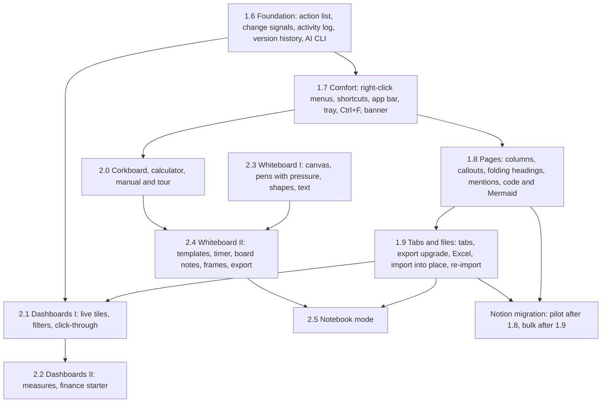

# Notaya version plan: 1.6 to 1.9, then 2.0 to 2.5

- **Who and where:** Ahmed's side (`AE0101`), written by Claude in the cloud thread "Plan versions 1.6 to 1.8 and beyond", 2026-11-07, started 23:39:51 UTC (container clock).
- **Asked by:** Ahmed, project chat 2026-11-07 23:39:31 UTC: "push full throttle ... plan out for all of these structures and possibly updating Notion Hub ... spreading out the features across how many versions ... very small features and big features ... that CLI list and all of the features that we've discussed previously". This is **Phase 2 (planning and staging)** in Ahmed's order of work (21:14:10 UTC: discuss, then plan and stage, then build).
- **Baseline:** `CipherVaults/Notaya` `main` at `9e3e4e3` (merge of PR #60), app version **1.5.1** (accepted by Mohamed 2026-11-05). Nothing after 1.5.1 is built.
- **Read in full before writing:** the full feature inventory (`2026-11-07-notaya-full-feature-inventory.md`), the dashboards, whiteboard and import/export studies, the Notion parity study (`2026-11-07-notion-parity-study.md`, 23:41 UTC), the AI CLI action list (`2026-11-07-ai-cli-action-list.md`, see section 5), the model-choice guide, `docs/STATUS.md` (next permitted action), the amendments record (A37 and its dated note), the agreed-feature list in project memory, and the Version Feature Board (28 planned and candidate cards).
- **Updated:** 2026-11-07, about 23:56 UTC (container clock), with Ahmed's answers (section 0) and the renumbering 1.10–1.15 to 2.0–2.5. Updated again 2026-11-08 about 00:05 UTC (container clock) with Ahmed's answers of 23:58:44 UTC (tablets, emoji in PDF, Excel), the Notion survey's round-2 gaps (coordinator's note 23:59:42 UTC) and the exchange folder placed next to the data folder (EX-2026-11-08-54).
- **Result state:** *produced*. This is a plan for Ahmed to read and adjust. It is not accepted, and **nothing here is a go to build**: building a version starts on Ahmed's word, and each security-behaviour change, new dependency or vault-format change still needs his own words (CLAUDE.md, A37).

> **Repository copy (EX-2026-11-07-50, updated in EX-2026-11-07-53 and EX-2026-11-08-54).** The working copy lives in the Claude project's shared files (`notes/2026-11-07-version-plan.md`); this committed copy is what Mohamed's Claude and later threads can read. The study files named below (inventory, dashboards, whiteboard, import/export, Notion parity, AI CLI action list) are in the project's shared files, not in this repository. **This is a plan, not a go to build**: nothing here is greenlit until Ahmed says so (A37 item 9 and its dated note; Ahmed 23:39:31 UTC authorized planning only).

---

## 0. Ahmed's answers (2026-11-07 23:53:46, 23:54:20 and 23:58:44 UTC, project chat)

Recorded by the planning thread from Ahmed's two messages (quoted parts in quotation marks). They change the plan as shown.

| Topic | Ahmed's answer | What changes in the plan |
|---|---|---|
| Version numbers | "after 1.9, it should be 2.0 ... It's just natural" | The old 1.10 to 1.15 are now **2.0 to 2.5** (plan IDs too: 1.10-1 is now 2.0-1, and so on) |
| Order | "it's up to you" | The coordinator's order stands (this plan's order) |
| Names in About | "should be moving to 1.6. It's tiny" | Confirmed in 1.6 (1.6-14) |
| AI and handwriting | "The AI shouldn't bother with handwriting" | Confirmed: on the whiteboard the AI works with shapes, text and notes, never freehand drawing |
| AI levels | "I agree with the 4 levels"; the AI "should be able to have full authority", for example to delete whole pages or hubs when asked | Confirmed: Off, Look, Edit, Full. Full can delete large parts (still to the recycle bin, with the window confirm) |
| Hidden notebooks | "the idea of hide notebooks from AI. That's good" | Added to 1.6-6: notebooks the person hides from the AI in Settings |
| Big-change confirm | "optional ... not something that's all like have to be forced"; "20 I guess is good enough" | A Settings switch (on by default is a spec choice), threshold 20 items |
| Files for the AI | "something that's inside of the app itself ... when it's installed and when it's portable, something that's containable" | The exchange folder sits **next to Notaya's own data folder** (not inside it, so the data folder keeps only encrypted files; coordinator's default relayed 23:55:39 UTC, used in the 1.6 spec), travels with the installed and the portable copy, and is never a folder picked anywhere on the PC (1.7-12) |
| Page lock, "lock now" | "I don't want to answer anything about locking pages right now" | Deferred; not in any version yet |
| Board snapshots (the AI looks at a picture of a board) | "pictures, I agree" | Allowed (spec details in 2.3 and 2.4) |
| Two AIs at once | fine "as long as Claude and Codex do not collide", working "on two separate things", with good coordination | Allowed in 1.6-6, each AI its own pairing and level; the clash protection of 1.6-2 refuses a write to an item another writer just changed; the activity log shows which AI did what |
| Tablets (23:58:44) | "I want it to be broad, not just specific to my tablet" | 2.3-2: pressure from any tablet or pen screen Windows supports |
| PDF and emoji (23:58:44) | emoji "should be there, and PDFs exports definitely it's critical" | New 1.7-13 (moved up from 1.9-3): Greek, Cyrillic and emoji in PDF |
| Excel (23:58:44) | charts "Yes, definitely, if possible. If not, it should be plain tables"; "the imports from Excel should actually add to databases" | 1.9-5 now includes charts (library `rust_xlsxwriter`); new 1.9-11 Excel import into databases (library `calamine`) |
| Notion survey, round 2 (coordinator's note of 23:59:42 UTC; order is the coordinator's call, Ahmed 23:54:20) | The full read-only survey found nine more things Ahmed's Notion uses | Placed in 1.8 and 1.9 (see the rows marked "Survey round 2"); hub home pages are rebuilt from Claude's read through the connector, not from the export (section 6). Formula reading, German copies, right-to-left and notebook layout stay open as questions 30 to 33 in the project chat |
| The bridge (how the AI reaches Notaya) | "I'm not sure" | Kept as the proposal (a companion program speaking MCP over a local pipe); decided in the 1.6 spec |

## 1. The short version

1. **Ten versions, 1.6 to 1.9 and then 2.0 to 2.5, in four waves.** Each version has one clear theme, a few big pieces and a handful of small ones, so no release is crammed (Ahmed 20:41:50 UTC: "stage it ... to what is actually doable").
2. **Foundation first.** Version 1.6 builds the AI CLI and its safety net (activity log, page version history, "something changed" signals, one list of named actions), plus quick fixes you will notice on day one. Everything later is built on top of that and ships with its own AI actions from the start.
3. **Then comfort, then pages, then files.** 1.7 makes the app yours (right-click menus, shortcuts, app bar, tray, Ctrl+F, banner). 1.8 makes pages rich enough to hold your Notion hubs (columns, coloured callouts, folding headings, mentions and backlinks, view links, code languages, Mermaid). 1.9 brings tabs and the full import/export upgrade that the Notion migration needs.
4. **Then the big rooms, as version 2.** After 1.9 comes **2.0** (Ahmed, 23:54:20 UTC): 2.0 the sticky corkboard, calculator upgrades and the in-app manual and tour. 2.1 and 2.2 dashboards (its three agreed steps). 2.3 and 2.4 the whiteboard. 2.5 Notebook mode, which reuses the whiteboard's engine.
5. **The Notion migration runs alongside**, not as one version: the pilot can start after 1.8 (pages) and the bulk import after 1.9 (import into an existing place, re-import without duplicates).
6. **Sizes, not dates.** Every item has a size (XS, S, M, L, XL). No dates are promised.

---

## 2. How to read this plan

| Size | Meaning (rough, for Codex at xhigh with one Claude review) |
|---|---|
| **XS** | A few lines; less than an hour of building |
| **S** | A small, contained change; about a day |
| **M** | A feature touching a few files and both sides (Rust and screens); a few days |
| **L** | A real feature with new data and several screens; about a week |
| **XL** | A large feature with its own design study, built in steps; more than one week |

- "**Big**" on the Notion board means L or XL; "**Small**" means XS, S or M.
- "**Gate**" marks something that needs **Ahmed's own words** before building: a security-behaviour change, a new dependency (library or plugin), or a **vault-format change** (an older Notaya cannot open the newer vault, so a backup is made first, as in 1.5.0).
- "**Addition**" marks something nobody asked for that I suggest (A37 item 7).
- Every feature gets **named AI actions** in the same version it ships (Ahmed 20:38:34 UTC). Section 5 says how.

---

## 3. The dependency map (why this order)

The hard rules behind it:

1. **The AI CLI needs its safety net first.** The agreed security approach (22:49 UTC) says AI edits are undoable through version history, deletes go to the recycle bin after a confirmation, and every AI action is logged. So version history, the activity log and the confirmation step ship in the same version as the CLI, or before it.
2. **Anything that writes from outside needs "something changed" signals.** Today the open window keeps its own copy and can overwrite a change made elsewhere (inventory 6.1). That is fixed once, in 1.6, and then serves the AI CLI, live dashboards, tabs and the corkboard.
3. **One list of named actions powers everything.** Right-click menus, the app bar, shortcuts, the tray, the command palette and the AI CLI are all "a list of actions with a name, an icon and a key". Built once in 1.6 (for the CLI), shown to people in 1.7. *(Addition: this is my design suggestion; it makes each later feature cheaper.)*
4. **The whiteboard engine comes before Notebook mode** (agreed 23:27 UTC: Notebook mode shares it).
5. **The corkboard comes before the whiteboard's board notes**, because a board note can be linked to a real sticky note (Ahmed 23:23 UTC).
6. **Import into an existing place comes before the Notion bulk import**, or every refresh would duplicate everything (parity study 10.2).
7. **Dashboards use the same filter engine and change signals** that databases and 1.6 already have.

---

## 4. The versions

### Wave 1: foundation and comfort

#### Version 1.6 — "The foundation" (the AI can work with Notaya, safely)

**Theme:** the invisible base everything else stands on, plus quick fixes you see on day one.

| # | Item | Size | What it means for you | Notes |
|---|---|---|---|---|
| 1.6-1 | **One list of named actions** (inside the app) | M | Nothing visible yet: every action Notaya can do gets one name, so menus, keys and the AI all call the same thing | Base for 1.7 and the CLI. Addition (design) |
| 1.6-2 | **"Something changed" signals, small saves and edit-clash protection** | L | If the AI (or a second window) changes a page, the open window refreshes instead of overwriting it; if you are typing in the same place, you win and the AI is told to read again | Fixes the risk found in the inventory (6.1); "small saves" = one block, row or property at a time with a version number (action list 10.2 and 10.3) |
| 1.6-3 | **Activity log** | M | A list of who changed what and when: you or "with Claude"; kept encrypted; can't be quietly edited | Shown in Settings in 1.6; the full panel comes in 1.8. Gate: security design |
| 1.6-4 | **Page version history, first step** | L | Every page keeps earlier versions; open the timeline, view an old version, restore it | Needed for "AI edits can be undone". Highlighting what changed comes in 1.8 |
| 1.6-5 | **Recycle bin for everything** | M | Notebooks, sections, database rows and sticky notes also go to Trash first (today only pages and databases do) | Action list 10.6; boards and dashboards join when they exist |
| 1.6-6 | **AI CLI, first release** (action-list steps A and B) | XL | Claude or Codex, from outside, can read and explain everything in Notaya and then edit notebooks, sections, pages, blocks, databases and sticky notes; deletes always ask you first in the Notaya window; "Claude is working" marker with a Stop button | Door: the "Notaya bridge" speaking MCP over a local pipe only your Windows account can open, with pairing; **off by default**; levels Off, Look, Edit, Full set only in Settings (confirmed by Ahmed 23:53:46 UTC); notebooks you hide from the AI; an optional big-change confirm (20 items); Claude and Codex may both be connected, each with its own pairing and level, kept apart by the clash protection; locked stays locked. Section 5. **Gate:** security behaviour, new promises P30–P33, maybe a dependency |
| 1.6-7 | **Fix: inline databases vanish from exports** | S | A database inside a page now appears in its PDF, Word, Markdown and HTML export | Bug confirmed in code (inventory 3.9) |
| 1.6-8 | **Fix: the Import window's out-of-date sentence** | XS | It no longer says databases are not imported (they are) | `ImportDialog.tsx` |
| 1.6-9 | **"+ New notebook" always visible** | XS | A modest "+ New notebook" line at the bottom of the notebook list (agreed 21:41 UTC) | Today it shows only on mouse-over |
| 1.6-10 | **Import and Export buttons in the top bar** | S | Two clear buttons with icon and label | Fixed buttons now; they become the first two app-bar defaults in 1.7 |
| 1.6-11 | **Icons pass** | S | Every icon checked in every theme; faded ones strengthened; Favorite star: clear outline when off, gold when on | Agreed 21:49 UTC |
| 1.6-12 | **Reopen where you left off** | S | Notaya opens on the page you were on, also after unlocking | Open tabs are restored once tabs exist (1.9) |
| 1.6-13 | **Drag databases in the sidebar** | S | Drag a database to reorder it among the pages (agreed 21:52 UTC) | Moving between notebooks stays a menu action |
| 1.6-14 | **Names in About** (moved up from 1.7) | XS | "Made by Mohamed Sayed and Ahmed Emara, with Claude and ChatGPT" | Addition (moved earlier because it is tiny). The full About page with licences is 2.0 |
| 1.6-15 | **The checks 1.5.1 never had** | S | The installer on a clean Windows user, the tray "Close sticky notes", the keyboard-layout shortcut, Word/PDF of the Notion import, Start with Windows at a real sign-in | From the board's "Later" card; done during the 1.6 PC round on throwaway data |

**Why this size is fair:** one XL (the CLI), one L (history), four M, the rest small. The small items are independent and can be built in parallel lanes.

#### Version 1.7 — "Your app, your way" (menus, keys, bars)

**Theme:** everything you click and press becomes customizable, built on 1.6's action list.

| # | Item | Size | What it means for you | Notes |
|---|---|---|---|---|
| 1.7-1 | **Right-click menus everywhere agreed** | L | Sidebar items (rename, icon, duplicate, move, export, delete), editor text (cut, copy, paste, "Turn into…"), database rows (open, duplicate, delete), links and pictures (open, copy link, copy image, save image), several items at once, keyboard hints, "Copy link to page"; empty sidebar space on trial | Tabs and sticky-note menus arrive with tabs (1.9) and the corkboard (2.0). No "Ask AI about this" (agreed) |
| 1.7-2 | **Customize the menus** | S | Settings: hide or turn off menu items | Agreed 22:45 UTC |
| 1.7-3 | **Duplicate page** | S | New: copy a page (with its sub-pages if you choose) | Needed by the menus; also a Notion parity gap |
| 1.7-4 | **Settings > Shortcuts** | M | One list of every action and its keys; rebind; warns about clashes; reset one or all | Agreed 21:37 UTC |
| 1.7-5 | **Global shortcuts** (work while Notaya is in the background) | M | Ctrl+Alt+N new sticky note; a calculator pop-up key | **Gate:** probably a new Tauri plugin |
| 1.7-6 | **Customizable app bar** | M | The top bar keeps sidebar toggle, back/forward, logo and search; plus your own strip of quick buttons: right-click > Customize, drag to add and reorder, Reset, icon or icon + label. Defaults: Import, Export, New page, New sticky note. Optional: Calculator, Today, Corkboard, Lock now, Theme, Settings, About, Whiteboard, AI log; pin any page | Agreed 21:21–21:23 UTC. Items appear as their features ship |
| 1.7-7 | **Richer tray menu** | S | Open, New page, New sticky note, Calculator, Quick search, Lock now, Show/hide all sticky notes, Close sticky notes, Quit | Agreed 22:43 UTC |
| 1.7-8 | **Ctrl+F: Notaya's own find bar** | M | Finds in the whole open page, including folded parts; "3 of 12"; Enter = next; "Search all notes" button | Agreed 21:35 UTC ("try it, tune later") |
| 1.7-9 | **Ctrl+H: find and replace** | S | Replace one or all in the open page | Agreed as an extra |
| 1.7-10 | **Home banner and page header** | M | Banner picture per time of day (picture or folder, shuffle, reset to built-in); taller banner like Notion; big page icon overlapping the banner; Settings with live preview (height, icon size, icon position); Change and Reposition buttons; per-page override | Agreed 23:08 UTC. Uses the existing picture store |
| 1.7-11 | **Full-width per page** | XS | One page can be wide while others stay normal | Parity study (P3); fits the per-page override |
| 1.7-12 | **AI CLI: files in and out** (action-list step C) | M | The AI can import, export and back up, but only through one exchange folder next to Notaya's own data folder (installed or portable; Ahmed 23:53:46 UTC "containable", placement beside the data folder is the coordinator's default of 23:55:39 UTC); every file written is logged and asks you first | Action list 8.8; import into a place and re-import follow in 1.9. **Gate:** security behaviour (a file door) |
| 1.7-13 | **Greek, Cyrillic and emoji in PDF** (moved up from 1.9) | M | No more "?" in PDF for these scripts and for emoji (Arabic and Hebrew already work) | Ahmed 23:58:44 UTC: emoji "should be there", PDF export "definitely ... critical". Noto Sans subset and the Noto Emoji font (OFL; black-and-white emoji, about a megabyte or more). **Gate:** dependency (fonts) |

#### Version 1.8 — "Pages that can hold your hubs"

**Theme:** the page features your Notion Home and hubs are built from (parity study, the five P1 gaps, plus the four page gaps the full survey found), plus code blocks and the history views.

| # | Item | Size | What it means for you | Notes |
|---|---|---|---|---|
| 1.8-1 | **Columns** (make them, not just show them) | M | Put blocks side by side, drag to resize | The code exists but creating it was removed in A13; revive with care. Parity P1 |
| 1.8-2 | **Callouts with colour and icon** | S | A highlight box keeps its background colour and its own emoji or picture icon | Parity P1; today Notion's colour becomes a text highlight |
| 1.8-3 | **Folding headings** | M | A heading that folds its section; imported toggles keep their open/closed state | Parity P1 |
| 1.8-4 | **@ mentions, backlinks and date chips** | L | Type @ to mention a page or a date; each page shows "Linked from" | Parity P1/P2. **Gate:** vault format (new inline kind) |
| 1.8-5 | **Link to a saved view of a database** | S | A link opens a database on a chosen view (for example "Overdue") | Parity P1 |
| 1.8-6 | **Code blocks: language picker, copy, wrap, exact text** | M | Every code block gets a language picker; Copy gives back the text **byte for byte** (spaces, tabs, line ends and invisible characters untouched), so the 9 PBS prompts and the JSON manifest still work after the move | Agreed 20:38 UTC; exact-copy rule from survey round 2 |
| 1.8-7 | **Mermaid as a code language** | M | Choose "Mermaid" (or paste Mermaid text and it is spotted) and it is drawn; code folded behind a click; zoom, download as picture, copy, wrap; the old Diagram block merges into this | Agreed 20:38 UTC; keep today's safety limits |
| 1.8-8 | **History: see what changed** | M | Old versions show added and removed text highlighted | Builds on 1.6-4 |
| 1.8-9 | **Activity panel** | M | A panel listing recent changes, AI ones marked "with Claude"; click to open the page or its version | Builds on 1.6-3 |
| 1.8-10 | **File, audio, video and web-link cards** | M | Attach any file to a page (ZIP, CSV, receipt, text and Markdown files open again from the page); play audio and video kept in the vault; a link card for a web address (no internet fetch) | Raised to P1 by survey round 2 (the PBS hub keeps a 56-file ZIP and a receipt inside folding sections). **Gate:** vault size limits; no network |
| 1.8-11 | **Links to one block in another page** | M | A link can land on one paragraph or heading inside another page, not just the page; it keeps working after the target moves | Survey round 2: about 57 in the PBS family. Every block gets a stable id. **Gate:** vault format |
| 1.8-12 | **Contents block** | S | A block that lists the page's headings and jumps to them; updates itself | Survey round 2: on 8 or more pages, often inside a "Jump to a section" fold. Uses the heading ids of 1.8-11 |
| 1.8-13 | **Text direction per block, kept exactly** | M | Each block can be set right-to-left or left-to-right (automatic stays the default), a page can have its own default, and the invisible direction characters inside titles and lines are **kept exactly as stored**, never "cleaned" | Survey round 2 (German course, Arabic hubs). Builds on the accepted V1.5 automatic direction. How Notion stores it is question 32 (open) |
| 1.8-14 | **Remember each item's Notion id on import** | S | Every imported page, block and row keeps its Notion id, so links and mentions find the right copy even when titles repeat (three copies of each German lesson) | Survey round 2 (0.4 point 3). The base for re-import (1.9-8) and the sync ledger (1.9-17) |

**After 1.8:** the Notion migration **pilot** can run on throwaway data (parity study M2), on **Workspace Home, the Projects and Ideas registry and one finance database** (survey round 2). A pilot run that goes wrong is simply re-run into a fresh throwaway vault, so the pilot does not wait for re-import (1.9-8); this keeps 1.8 at a buildable size instead of pulling the whole import set forward. The finance database is compared value for value only after the formula route is settled (question 30).

#### Version 1.9 — "Tabs and files in and out"

**Theme:** work in several pages at once, and get files in and out the way the Notion backup needs.

| # | Item | Size | What it means for you | Notes |
|---|---|---|---|---|
| 1.9-1 | **Page tabs** | L | Browser-style tabs: + new tab, pin, groups, close, move left/right, reopen closed (Ctrl+Shift+T); tab right-click menu; open tabs restored on restart | Agreed 21:28 UTC. Each tab must save before a lock |
| 1.9-2 | **PDF that reads like a book** | M | A printed contents page, bookmarks nested like the sidebar, clickable links between pages | Agreed (export study) |
| 1.9-3 | *(moved to 1.7-13: PDF export is critical, Ahmed 23:58:44 UTC)* | – | – | – |
| 1.9-4 | **Word contents page** | S | A Word export starts with a table of contents | |
| 1.9-5 | **Excel (.xlsx) for databases, with charts** | L | Export a database or a view as a real Excel file with numbers and dates, and the view's chart as a real Excel chart where it can be done; otherwise plain tables (Ahmed 23:58:44 UTC: charts "if possible ... if not, it should be plain tables") | Charts need the Excel library `rust_xlsxwriter` (MIT/Apache-2.0) from the start instead of our own small writer (dependency study, section 6). **Gate:** dependency |
| 1.9-6 | **Databases inside page and notebook exports** | M | A notebook export includes its databases, and they come back in on re-import | Agreed (export study gap 6) |
| 1.9-7 | **Import into an existing place** | M | Import into this notebook, section or page, not always a new notebook | Parity P1 |
| 1.9-8 | **Re-import without duplicates** (by Notion id) | L | A second import of the same export updates what is there and lists what changed; edits you made in Notaya are kept as a second version, not overwritten | Parity P1; the monthly refresh (parity 10.3, option A) |
| 1.9-9 | **"What did not carry over" report and counts check** | S | After an import: pages, rows and pictures counted against the export, and a list of what was simplified | Addition from the parity study (section 8) |
| 1.9-10 | **Keep Notion's original dates** | S | Imported pages keep their Notion created and edited dates | Parity P2 (to check first) |
| 1.9-11 | **Import Excel files into databases** | M | Pick an .xlsx file: each sheet becomes a database (or adds rows to an existing one), with numbers and dates kept | Ahmed 23:58:44 UTC: "the imports from Excel should actually add to databases". Uses the reader library `calamine` (MIT). **Gate:** dependency |
| 1.9-12 | **Saved views carried across** | M | Each Notion database comes in with its saved views (filters including AND/OR groups, sorts, grouping, board column order, hidden properties), so "Overdue" in Notion is "Overdue" in Notaya | Survey round 2 (the "Notion-view reader"; 187 saved views in the workspace). Read through the connector by the AI and written through the AI CLI |
| 1.9-13 | **Property descriptions** | S | A property can carry a description shown on hover, like Notion's | Survey round 2: the finance databases rely on them (38 of 69 on Events) |
| 1.9-14 | **Row page layouts** | M | A row's page can pin chosen properties at the top, group the rest into named sections, hide empty ones and fold groups | Survey round 2: Events and Summaries in the finance system |
| 1.9-15 | **Status groups: check the import** (to do, in progress, complete) | XS | Notion's Status options land in the right group when imported | Survey round 2 asked for groups, but Notaya's Status property **already has the three groups** (`database/types.rs`, read for the 1.6 spec on `a1bb70d`). Only check that the Notion importer and boards use them; no new feature |
| 1.9-16 | **Page templates, a default per database, and repeating templates** | M | Templates for ordinary pages (not only database rows); a database can name its default template; a template can make a new row by itself every day (for example the habit tracker) | Survey round 2. Row templates already exist (inventory) |
| 1.9-17 | **Sync ledger** | M | Notaya keeps one list of everything that came from Notion: Notion id, Notaya page, last edited, state. The monthly AI-driven refresh reads it to touch only what changed and to report what it could not see | Survey round 2 (0.6). Builds on 1.8-14 |

**After 1.9:** the Notion **bulk import** (parity M3 to M5) and the manual, AI-driven refresh can run.

### Wave 2 (version 2): the sticky corkboard and dashboards

#### Version 2.0 — "Corkboard, calculator, manual"

| # | Item | Size | What it means for you | Notes |
|---|---|---|---|---|
| 2.0-1 | **Sticky corkboard** | L | In-app corkboard with Grid and Free modes; drag; box-select; coloured pins; coloured strings between notes; right-click menu; create from the tray | Agreed 20:31–20:33 UTC; desktop floating notes and Keep on top already exist |
| 2.0-2 | **Calculator: history panel** | S | History on the right side of the calculator | Agreed 21:37 UTC |
| 2.0-3 | **Calculator: unit converters** | M | Windows-style offline converters (length, weight, temperature, area, volume, time, data…) | No internet features (agreed) |
| 2.0-4 | **In-app Manual** | L | A browsable feature guide inside Notaya with pictures, clear icons and longer explanations; the same content kept as an outside guide we update with every release | Agreed 23:04 UTC. The outside guide starts in 1.6 and grows each release |
| 2.0-5 | **Tour** | S | A short, skippable overview; replay from Settings | Agreed 23:04 UTC; placed after the app bar, tabs and menus have settled so it does not go stale |
| 2.0-6 | **About page, the professional side** | S | Credits for both partners, proper open-source references and licences, Notaya's own notes | Agreed 23:04 UTC. A public licence still needs both partners |
| 2.0-7 | **Notaya's own icon set** | M | Line icons drawn for Notaya, usable for pages, notebooks and databases (pictures allowed for notebooks and databases too) | Parity P2. Our own artwork, no brand assets |

#### Version 2.1 — "Dashboards I: live tiles and filters" (agreed steps 1 and 2)

| # | Item | Size | What it means for you | Notes |
|---|---|---|---|---|
| 2.1-1 | **Dashboard pages with live tiles** | XL | A new item next to pages and databases; pages of tiles you drag and resize: number cards, bar/column, line, donut **and pie**, table, text; always read live from your databases | Agreed 23:02 UTC step 1. **Gate:** vault format (new item kind) |
| 2.1-2 | **Filters, slicers, Reset and click-through** | L | Slicers (drop-down, list, buttons, date range, search), click a bar to filter the others, an active-filters strip with Reset, open details, open the record | Agreed step 2 |
| 2.1-3 | **Embed a dashboard in a page** | S | Show a dashboard (or one tile) inside a page | Study suggestion |

#### Version 2.2 — "Dashboards II: measures" (agreed step 3)

| # | Item | Size | What it means for you | Notes |
|---|---|---|---|---|
| 2.2-1 | **Named reusable calculations (measures)** | XL | "Total spent = sum of Amount where Kind is Expense", defined once, used anywhere; a sentence builder and the existing formula language; previous period, share of total, top N | Agreed step 3; sandboxed in the Rust core |
| 2.2-2 | **Matrix tile, partial-period marks, data-health tiles, snapshots** | M | The study's "honesty" features | Study section 4.5; snapshots optional |
| 2.2-3 | **Finance starter template** | M | A starter that builds your report shape from a made-up dataset (never your real data) | Study question 7 |
| 2.2-4 | **Database page layout, property descriptions, quick filter chips** | M | Rows open with your chosen layout; properties can have a description; quick filter chips on a view | Parity P2 items that your finance system uses |

### Wave 3 (version 2): the whiteboard

#### Version 2.3 — "Whiteboard I: draw and arrange"

| # | Item | Size | What it means for you | Notes |
|---|---|---|---|---|
| 2.3-1 | **Board canvas** | L | Its own section like Sticky notes; infinite canvas, pan and zoom, backgrounds and patterns, undo, autosave | Agreed 23:16–23:23 UTC. **Gate:** vault format; a stroke library (study first) |
| 2.3-2 | **Pens with pressure** | L | Pen, pencil, marker, highlighter, eraser, your own pens; **pressure from any drawing tablet or pen screen** that Windows supports (not tuned to one brand or model), tablet eraser end, palm rejection; mouse and touch | Core. Ahmed 23:58:44 UTC: "broad, not just specific to my tablet": built on the standard Windows pen input, tested on his tablet plus mouse and touch |
| 2.3-3 | **Shapes, lines, text** | M | Shapes, arrows, text boxes, automatic shapes | |
| 2.3-4 | **Select, move, ruler, insert space** | M | Select, lasso, group, align; the ruler with the degree dial; insert space | OneNote Draw tab as the style model |

#### Version 2.4 — "Whiteboard II: templates and board notes"

| # | Item | Size | What it means for you | Notes |
|---|---|---|---|---|
| 2.4-1 | **Connectors** | M | Arrows that stay attached to boxes | |
| 2.4-2 | **Board sticky notes, linked or separate** | M | Per note: linked to a real sticky note, or a separate copy | Ahmed 23:23 UTC. Needs the 2.0 corkboard |
| 2.4-3 | **Pictures and frames** | M | Pictures on the board; named frames; present frame by frame | |
| 2.4-4 | **First five templates** | M | Weekly planner, Kanban, mind map, SWOT, lined page; save your own | Our own originals, no Microsoft assets |
| 2.4-5 | **Timer and stopwatch** | S | A countdown on the board | Ahmed's addition |
| 2.4-6 | **Export and print** | S | PNG, PDF (a page per frame), copy | |

### Wave 4 (version 2): Notebook mode

#### Version 2.5 — "Notebook mode"

| # | Item | Size | What it means for you | Notes |
|---|---|---|---|---|
| 2.5-1 | **Notebook mode, chosen per notebook** | XL | Names: "Default style" (Notion-like) and "Notebook mode"; coloured section tabs on top, the page list with sub-pages on the right, pages as free canvases (click anywhere to type, drag boxes) | Agreed 23:27–23:29 UTC. Reuses the whiteboard engine |
| 2.5-2 | **Free-canvas single pages** | M | Switch one page in a Default-style notebook to a free canvas | Agreed |
| 2.5-3 | **Everything still works** | M | Search, Ctrl+F, export, history, lock and the AI CLI on canvas pages | Agreed |

### Later (not placed yet)

| Item | Why later | Source |
|---|---|---|
| Synced blocks | Only one found, and its source cannot be read through the connector; it comes in as a plain copy and is listed in the "did not carry" report | Survey round 2 (P3) |
| A button block inside a page | Notion's button actions cannot be read through the connector; the habit tracker's four buttons are rebuilt by hand with Notaya's existing Button property and automations | Survey round 2 |
| Gallery cover from page content | P3 | Parity study |
| Notion "companion tool" for automatic backup (a separate program with a read-only Notion key) | Needs Ahmed's yes on a key and a security review | Parity 10.3 option C |
| Write back from Notaya to Notion | Last; needs Ahmed's yes on writes | Parity 10.4 |
| Whiteboard later list: effect pens, handwriting to text, laser pointer, layers, mind-map mode | Whiteboard study "LATER" | Whiteboard study |
| Decide open audit findings; clean code-checker warnings; per-line text direction in exports; lighter big imports | Board "Later" cards | Notion board |
| Notaya's own licence and going public | Needs both partners | CLAUDE.md |

---

## 5. The AI CLI: how its actions are staged

The detailed list of actions is in `2026-11-07-ai-cli-action-list.md` (thread "Draft the full AI CLI action list"); this section only stages it. See section 5.3 for how that list was folded in.

### 5.1 The rule

**Each version ships the AI actions for its own features.** 1.6 builds the engine and the actions for everything that exists today. From 1.7 on, a feature is not "done" until its named actions, their permission level and their log entries exist. The CLI never gets a version of its own again.

### 5.2 What the first release (1.6) holds

The action list (about 300 actions in about 25 areas) proposes three build steps (its section 11). This plan puts **steps A and B in 1.6** and **step C in 1.7**:

| Part | What it is | Version |
|---|---|---|
| The door | The **Notaya bridge**: a small companion program that speaks MCP (the standard tool protocol Claude Code and Codex already use) and talks to the running Notaya over a Windows named pipe only Ahmed's account can open; no network port; first-time **pairing** shown in the Notaya window; pairings removable in Settings | 1.6 |
| Off by default, four levels | **Off** (default), **Look** (read only), **Edit** (create, change, move; deletes to the bin after Ask), **Full** (Edit plus files through the exchange folder, look and non-security settings, emptying the bin with Strong). Set only in Settings > AI access; the AI can never see or change it. Full can delete large parts (whole pages or hubs) when asked, still to the recycle bin with the window confirm. Plus **hidden notebooks** the AI cannot see (Ahmed: "That's good") | 1.6 (Full's file part in 1.7) |
| Confirmations | None for ordinary edits (undoable); **Ask** (one click in the Notaya window); **Strong** (type a word). Only in the Notaya window, never in the AI's chat. The **big-change confirm** (one request touching more than 20 items) is an optional Settings switch, not forced (Ahmed 23:53:46 UTC) | 1.6 |
| Two AIs at once | Claude and Codex may both be connected, each with its own pairing and level; a write to an item the other just changed is refused ("read it again"); the log shows which AI did what; the coordinator keeps them on separate work | 1.6 |
| Locked stays locked; the person wins | Every action refuses while locked; a write clashing with your typing is refused ("read it again") | 1.6 |
| Undo and log | Each AI request is one "change set" in the tamper-evident (hash-chained, encrypted) activity log, marked "with Claude" or "with Codex"; page edits also land in version history | 1.6 |
| Step A, Look | Read and explain everything that exists: tree, pages as Markdown, databases, search, sticky notes, calculator, settings; `ai.*`, `ui.open`, `ui.notify` | 1.6 |
| Step B, Edit | Edit actions for notebooks, sections, pages, blocks, databases, sticky notes, with small saves, the recycle bins, `activity.undo` and version history | 1.6 |
| Step C, Files | The exchange folder (next to Notaya's own data folder, installed or portable), `import.*`, `export.*`, `backup.now` | 1.7 (1.7-12) |
| Never for the AI | Passwords, keyfiles, security on or off, restore and start over, the AI switch itself, opening programs, web links or Windows folders, the clipboard | always |

### 5.3 Actions that arrive with later versions

| Version | New AI actions (names follow the action list) |
|---|---|
| 1.7 | Files through the exchange folder (import, export, backup); menus, shortcuts, app bar (the AI can arrange the bar), find and replace in a page, banner and page-header settings |
| 1.8 | Columns, callouts, folding headings, mentions and backlinks, view links, block links and the contents block, text direction per block, code language and Mermaid, history (list, view, restore), activity log read; open a page by its Notion id |
| 1.9 | Tabs (open, pin, close, group), export with contents page and Excel (with charts), Excel import into databases, import into a place, re-import, the "did not carry" report, counts check; saved views, property descriptions, row page layouts, Status groups, templates; **list the sync ledger** and **compare a page with its Notion original** (the AI reads Notion through the connector, Notaya never goes online) |
| 2.0 | Corkboard (positions, pins, strings, modes), calculator history and converters, open the manual page for a feature |
| 2.1–2.2 | Dashboards: create, add tile, set filter, add slicer, define a measure, snapshot |
| 2.3–2.4 | Whiteboard: shapes, text, notes, connectors, frames, templates, timer (confirmed by Ahmed 23:54:20 UTC: the AI works with shapes, text and notes, never freehand drawing; it may look at a picture of a board) |
| 2.5 | Switch a notebook or page to Notebook mode and back; place boxes on a canvas page |

---

## 6. The Notion migration track

Not a version of its own: it follows the features it needs (parity study section 10).

| Step | What | Can start after | Needs Ahmed |
|---|---|---|---|
| M0 | Read-only survey of the whole Notion workspace | **Done** (approved 23:49:01 UTC; parity study section 0) | – |
| M1 | Fix the build list from the survey | **Done** in this plan (1.8-10 to 1.8-14, 1.9-12 to 1.9-17) | – |
| M2 | Pilot on Workspace Home, the Projects and Ideas registry and one finance database, on throwaway data, with the "ten most-used pages" test | 1.8 | Finance numbers only after the formula route (question 30) |
| M3 | Bulk import with the "did not carry" report and counts | 1.9 | – |
| M4 | **Hub home pages rebuilt from Claude's read through the connector** (about 15 homes: columns, colour callouts, mentions, view links and folds survive there, not in the export), plus saved views, layouts, descriptions and covers | 1.9 + the AI CLI | – |
| M5 | Check: counts, sample compare, your ten most-used pages | M4 | Your walk through ten pages |
| M6 | Final copy; then a monthly refresh from your own export | M5 | – |
| – | Finance formulas: the connector reads neither formula text nor values. Route proposed in the survey (0.7): read the text read-only in Ahmed's own Notion, rebuild, then compare every value with Notion's CSV export; zero differences is the pass mark | Formula route answer | Yes (question 30, open) |
| – | Ongoing backup: manual, AI-driven, quality-checked, never automatic (Ahmed 23:49 UTC); first copy from the export, then the AI upgrades homes and views; monthly runs touch only what changed, using the sync ledger (1.9-17) | 1.9 | – |

---

## 7. How each version is built (the same cycle every time)

1. **Spec** (Opus high; xhigh only for the AI CLI security model): the work packages, files touched, what must not break, the AI actions, the security notes, the tests. Ahmed reads the plain-words part.
2. **Build** (Codex, GPT-6.1 Sol, xhigh): one package per lane; lanes that touch different files run in parallel.
3. **Review** (one Opus 5.5 xhigh review per substantive diff, never the author) and the **security review** for every code PR.
4. **Checks in the cloud:** Rust tests under Wine, type check, build, `npm audit`, the mock-UI scripts. Anything not run is reported as not run.
5. **PC round on throwaway data** in `D:\Notaya Tests`, never anyone's real vault; pen and tablet tests only on Ahmed's PC.
6. **Release** when the coordinator judges it ready (A37 item 3), with release notes, a Session Summary entry, the usage ledger, the Notion hub, the handover guide (A39) and a clear milestone note for Mohamed.
7. **Acceptance** is Ahmed's own word (or Mohamed's on his side), never the merge or the release.

**Size check per version** (rough, counting S = 1, M = 3, L = 6, XL = 12):

| Version | Points | Big pieces |
|---|---:|---|
| 1.6 | about 45 | AI CLI (XL), version history (L), small saves (L) |
| 1.7 | about 36 | Right-click menus (L) |
| 1.8 | about 37 | Mentions and backlinks (L) |
| 1.9 | about 46 | Tabs (L), re-import (L), Excel with charts (L); the survey's database items add about 13 |
| 2.0 | about 25 | Corkboard (L), Manual (L) |
| 2.1 | about 20 | Dashboards I (XL + L) |
| 2.2 | about 21 | Measures (XL) |
| 2.3 | about 18 | Canvas and pens (L + L) |
| 2.4 | about 17 | Board notes, templates |
| 2.5 | about 18 | Notebook mode (XL) |

1.6 is the heaviest on purpose: it is the foundation. If it runs long, items 1.6-12 to 1.6-14 can move to 1.7 without harm. 1.9 grew with the survey's database items; if it runs long, 1.9-13, 1.9-14 and 1.9-16 (descriptions, row layouts, templates) can be split off into a short 1.9.x before 2.0 without touching the migration order, since the finance pilot waits for the formula answer anyway.

---

## 8. Gates that need Ahmed's own words (before that version is built)

| Version | Gate | Kind |
|---|---|---|
| 1.6 | The AI CLI door (bridge, named pipe, pairing), its four levels, confirmations and log; new security promises P30–P33 | Security behaviour |
| 1.7 | The AI's exchange folder (a file door) | Security behaviour |
| 1.6 | Any library the CLI channel needs | Dependency |
| 1.7 | Global shortcuts (likely a Tauri plugin) | Dependency |
| 1.8 | Mentions, columns, stable block ids, Notion ids and per-block direction in the vault (an older Notaya may not open it; backup first) | Vault format |
| 1.8 | File, audio and video blocks (size limits, no network) | Security behaviour |
| 1.7 | Fonts for Greek, Cyrillic and emoji in PDF (Noto, OFL) | Dependency |
| 1.9 | `rust_xlsxwriter` (Excel export with charts) and `calamine` (Excel import) | Dependency |
| 2.1 | The dashboard item kind | Vault format |
| 2.3 | The whiteboard item kind; a stroke-drawing library (a small licence study first) | Vault format, dependency |
| Migration | M0 count; a read-only Notion key (optional) | Ahmed's yes |

---

## 9. What can run in parallel now (planning work, before any build go)

These are cheap to do while the cloud credit lasts and make 1.6 faster once Ahmed says go:

1. **The 1.6 spec** (Opus high; the CLI security model at Opus xhigh): channel design, permission levels, activity-log format, version-history storage, change signals.
2. **A small dependency and licence study** (Sonnet high): stroke libraries for the whiteboard, a global-shortcut plugin, fonts for Arabic and Greek in PDF, an Excel writer (or our own).
3. **The outside Manual, first edition** (Sonnet high): written from the inventory, kept as an artifact and updated every release.
4. **The Notion M0 count** (only after Ahmed's yes).

---

## 10. Open questions for Ahmed (numbered)

Answered on 2026-11-07 at 23:53:46 and 23:54:20 UTC (section 0): order (coordinator's call, kept), version names (2.0 after 1.9), About names in 1.6 (yes), the AI and handwriting (never), and the AI CLI's levels, hidden notebooks, big-change confirm, file door, snapshots and two AIs. Still open:

1. **Columns and the other four Notion page gaps in 1.8** (parity questions 2 and 3): OK?
2. **Go for the planning work in section 9** (specs and studies only, nothing built)?
3. **Page lock and "lock now" for the AI:** deferred at Ahmed's word ("I don't want to answer anything about locking pages right now"); asked again when the 1.6 spec needs it.
4. **The bridge** (how the AI reaches Notaya): Ahmed is not sure; the 1.6 spec explains the proposal in plain words and asks once more.
5. **Where confirmations appear** (only in the Notaya window, recommended): not answered; the 1.6 spec keeps the recommendation unless Ahmed says otherwise.

Also open, asked in the project chat as **30 to 33** (from the survey, not repeated here): the formula route, the three German course copies, how Notion stores right-to-left, and the notebook layout. The plan places the features so that none of these answers changes the version order.

---

## 11. Records

- **Result state:** produced. Not verified, integrated or accepted.
- **Mirrored to:** the Notaya Notion hub (Version Feature Board cards and the Human Roadmap page), updated in the same thread.
- **Not done:** no code read beyond the inventory's findings, no build, no test, no app run. Sizes are judgement, not measurements.
